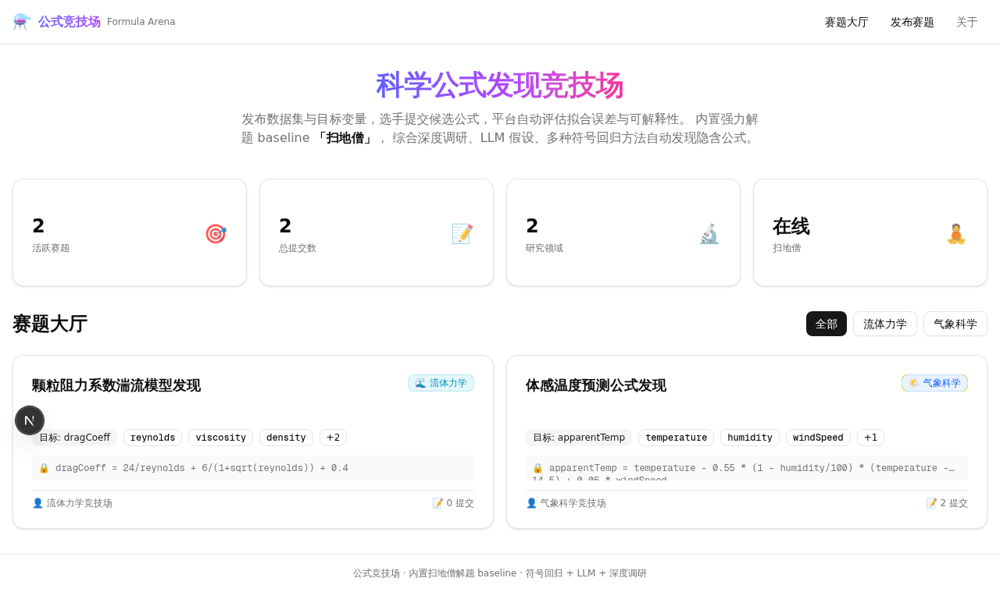
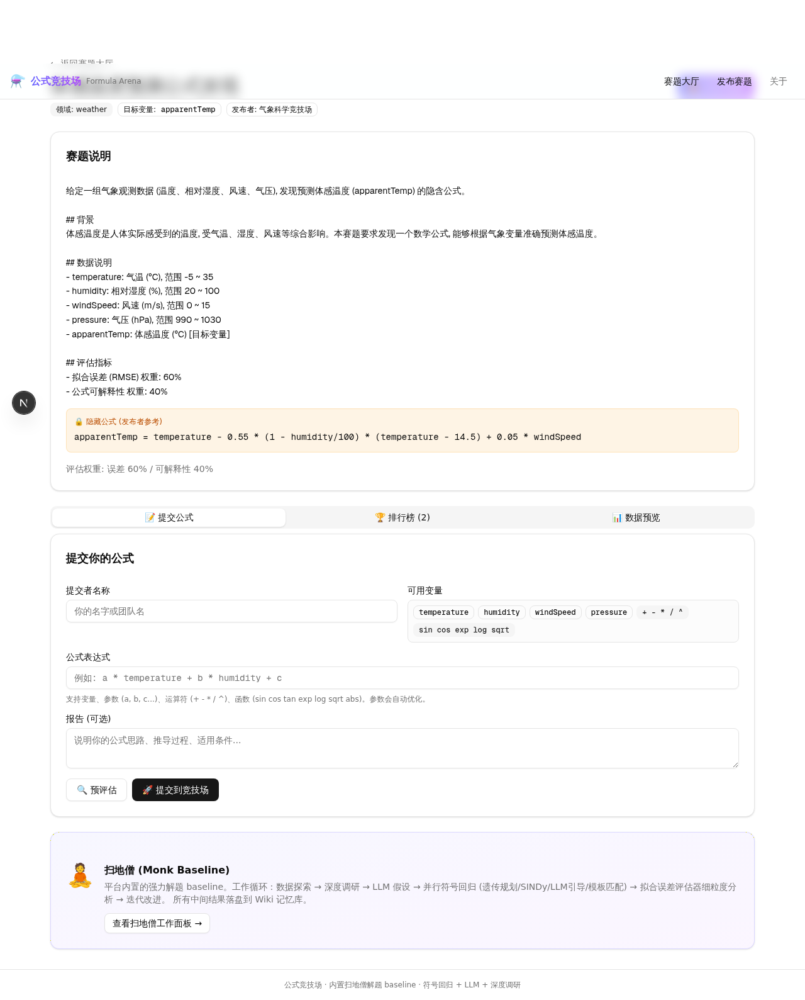
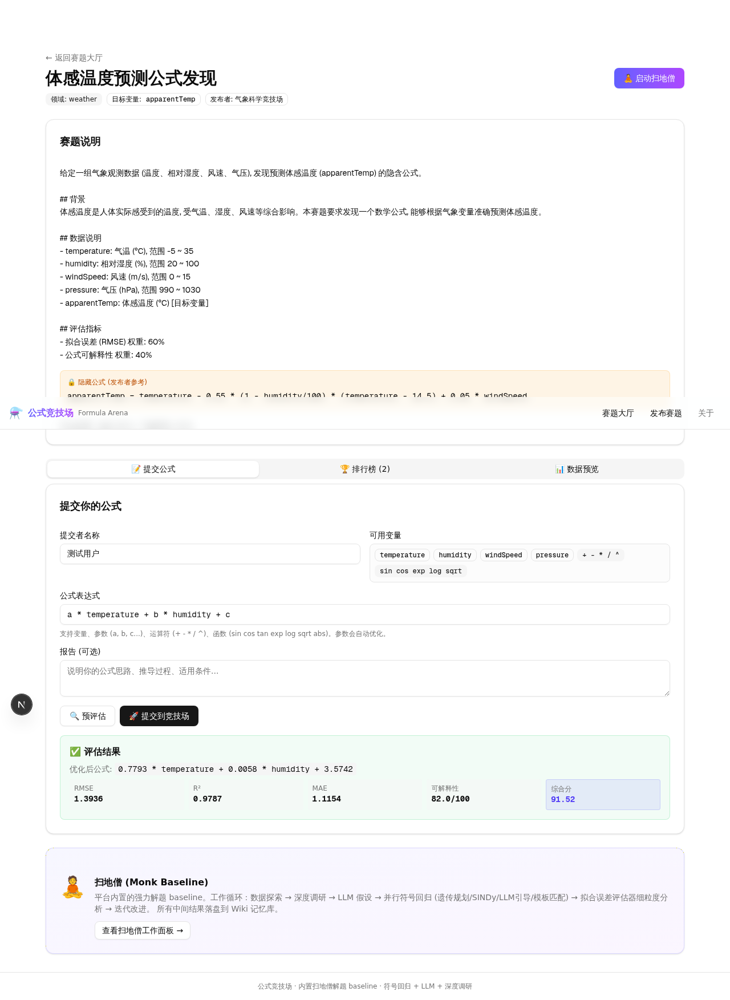
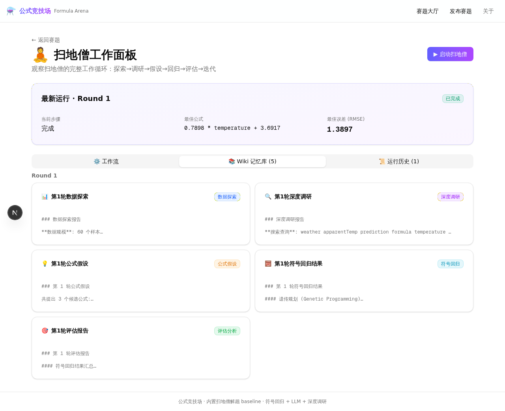
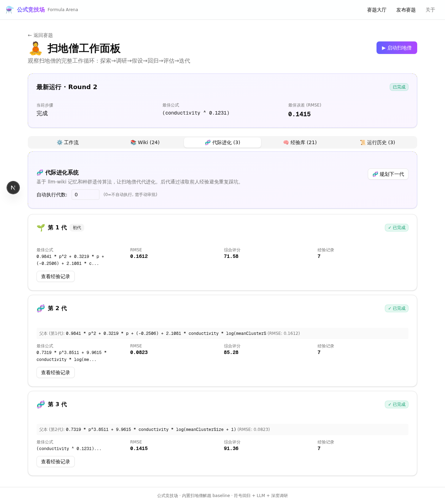
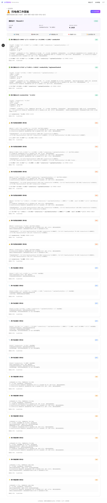

# 科学公式发现竞技场 · Formula Arena

一个用于科学公式发现的竞赛平台。研究者可以发布数据集与目标变量，提交候选公式，比较拟合误差和可解释性；内置智能体“扫地僧”会围绕赛题开展迭代研究。

## 网站界面

### 赛题大厅

浏览不同领域的公式发现任务，查看目标变量、可用数据集和当前提交情况。



### 赛题与公式评估

赛题详情展示变量、数据和评价指标。提交公式后，平台计算拟合指标并反馈优化结果。





### 扫地僧研究面板

扫地僧按轮次展示数据探索、深度调研、公式假设、符号回归和评估报告，便于观察每一步如何影响当前最佳公式。



### 代际进化与经验库

平台可以基于历史公式规划后续一代候选，并将可复用的经验保存在 Wiki 与经验库中。





## 扫地僧的工作逻辑

扫地僧以题目内置的 baseline 为起点，按以下循环推进：

1. **探索数据**：读取变量、样本分布及其关系。
2. **深度调研**：通过 MCP 搜索相关资料并阅读网页，为建模收集背景信息。
3. **提出假设**：结合数据与调研结果，生成候选公式和结构解释。
4. **符号回归**：使用遗传规划、SINDy、LLM 引导或模板方法搜索公式。
5. **评估与迭代**：按拟合误差和可解释性给候选评分，更新当前最佳公式，并把经验写入 Wiki，供后续轮次参考。

## 接入开源 MCP 服务

LLM、网页搜索和网页阅读通过官方开源 [MCP TypeScript Client](https://github.com/modelcontextprotocol/typescript-sdk) 与 MCP Streamable HTTP 服务通信。仓库包含 MCP 客户端，不绑定模型厂商；部署者需自行运行一个兼容的 MCP 服务，并为其配置模型与搜索/网页读取工具。

默认工具名称和输入约定如下，可通过环境变量改名：

| 用途 | 默认工具名 | 参数 | 返回值 |
| --- | --- | --- | --- |
| 对话生成 | `chat` | `{ messages, model?, temperature }` | 文本，或含 `text`、`content`、`response`、`answer` 的对象 |
| 网页搜索 | `web_search` | `{ query, num }` | 结果数组，或 `{ results: [...] }`；每项至少含 `url`，可含 `name/title`、`snippet`、`host_name` |
| 网页阅读 | `page_reader` | `{ url }` | 含 `content` 的对象；可带 `title`、`url`、`publishedTime`，也接受文本 |

配置 `.env`：

```dotenv
MCP_SERVER_URL=https://your-mcp-server.example.com/mcp
MCP_AUTH_TOKEN=your-bearer-token
MCP_CHAT_TOOL=chat
MCP_SEARCH_TOOL=web_search
MCP_READ_PAGE_TOOL=page_reader
```

如果 MCP 服务不需要 Bearer 认证，可以不设置 `MCP_AUTH_TOKEN`。请将凭据保存在本地环境，不要提交到 Git。

## 本地运行

需要 Bun 和 Node.js。先复制环境模板并填写数据库和 MCP 服务配置：

```sh
cp .env.example .env
bun install
bun run db:generate
bun run db:push
bun run dev
```

打开 `http://localhost:3000`。生产构建前请检查源码中启用的 `typescript.ignoreBuildErrors` 设置。

## Project 4 研究案例

网站源码被投入 [Zero2X Lab Research](https://zero2xlab.zero2x.org.cn/research)，经过多轮交互形成当前网站与 Project 4 研究成果。渗流阈值案例、数据和报告见 [`research/percolation/`](research/percolation/)。其中的拟合指标来自随附报告；本仓库整理时没有重新运行分析脚本。

## 许可证

本项目以 MIT License 开源，详见 [LICENSE](LICENSE)。
